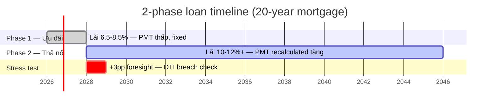

# 03 — Core math

Toàn bộ math là **pure function** ở `features/budget/utils/loan-math.ts` (71 LOC) + `pitia-calculator.ts`. Annuity (trả đều) — khớp cách ngân hàng VN tính.

## 1. PMT — Monthly payment from principal

Cho gốc $P$, lãi suất năm $\text{rate}\%$, kỳ hạn $y$ năm:

$$
\text{PMT} = P \cdot \frac{r(1+r)^n}{(1+r)^n - 1}
$$

với $r = \frac{\text{rate}}{1200}$ (lãi tháng), $n = 12y$ (số tháng).

```ts
calculateMonthlyPayment(principal, annualRate, years): number
// in loan-math.ts:13
```

Edge case: `r = 0` → `P / n` (no-interest loan).

## 2. PV — Loan amount from payment (inverse PMT)

Cho $\text{PMT}_{\max}$ (khoản trả tháng tối đa), suy ra max loan:

$$
\text{PV} = \text{PMT} \cdot \frac{1 - (1+r)^{-n}}{r}
$$

```ts
// budget-calculator.ts: calculateLoanFromPayment()
```

Đây là backbone của **income-based cap**: từ DTI ceiling → max PMT → max loan.

## 3. Remaining balance after N years

Sau $n$ tháng trả đều (trên tổng $N$ tháng):

$$
B_n = P \cdot \frac{(1+r)^N - (1+r)^n}{(1+r)^N - 1}
$$

```ts
calculateRemainingBalance(principal, annualRate, totalYears, yearsPaid): number
// in loan-math.ts:30
```

Quan trọng cho 2-phase loan: số dư cuối kỳ ưu đãi → cơ sở recalculate PMT giai đoạn thả nổi.

## 4. Two-phase loan (Vietnamese reality)



User shock thường xảy ra cuối năm 2 (cuối ưu đãi) — PMT có thể nhảy 30-50%. Engine ép safe-loan theo PMT phase 2 để tránh chỗ này.


Cách ngân hàng VN thực tế tính khoản vay nhà:

**Phase 1 — Ưu đãi** (`preferentialYears` đầu, thường 2):
- PMT tính theo `preferentialRate` cho **toàn kỳ hạn** (vd 20 năm).
- Chỉ thực sự trả `prefMonths = preferentialYears × 12` tháng.

**Phase 2 — Thả nổi** (`totalYears - preferentialYears` năm sau):
- Ngân hàng **recalculate** PMT trên `remainingPrincipal` (sau phase 1) tại `floatingRate` cho `remainingYears`.
- Đây là chỗ user dễ shock — PMT thường **tăng đáng kể**.

```ts
calculateRealisticFloatingPayment(P, prefRate, prefYears, floatRate, totalYears)
// loan-math.ts:50
```

### Total cost — `calculateTwoPhaseTotal()`

```
Phase1Paid = pmt1 × prefMonths
Phase1Principal = P - remainingBalanceAfterPref
Phase1Interest = Phase1Paid - Phase1Principal

Phase2Paid = pmt2 × floatMonths   (pmt2 recalc tại floatRate)
Phase2Interest = Phase2Paid - remainingPrincipal

totalInterestPaid = Phase1Interest + Phase2Interest
totalAmountPaid = principal + totalInterestPaid
```

→ Xuất hiện trong `loanAssumptions.totalInterestPaid` / `totalAmountPaid` của [[02-data-contracts|BudgetResult]].

## 5. Weighted average rate (reference)

$$
\text{wAvgRate} = \frac{\text{prefRate} \cdot \text{prefYears} + \text{floatRate} \cdot \text{floatYears}}{\text{totalYears}}
$$

```ts
// budget-calculator.ts: calculateWeightedRate()
```

Chỉ dùng để **display** (`loanAssumptions.weightedAverageRate`), không drive math chính. Engine luôn dùng 2 rate riêng biệt.

## 6. DTI ratio

$$
\text{DTI} = \frac{\text{monthlyDebt} + \text{newInstallment}}{\text{netIncome}} \times 100\%
$$

Engine dùng **floating-rate payment** ở tử số (worst-case sizing) — không phải preferential. Xem [[05-dti-perspectives]].

## 7. PITIA (ACM engine)

PITIA = **P**rincipal+Interest + property **T**ax + **I**nsurance + HOA/m**A**nagement.

```ts
PITIA.total = monthlyAnnuityPayment(P, prefRate, term)
            + (propertyValue × propertyTaxRate% / 12)
            + (loanPrincipal × insuranceRate% / 12)
            + (areaSqm × hoaPerSqmMonthly)
```

VN defaults (`ACM_DEFAULTS` ở `pitia-calculator.ts:15`):
- propertyTaxRate `0.03%/năm` (thuế nhà đất phi nông nghiệp)
- insuranceRate `0.55%/năm` (bảo hiểm khoản vay)
- hoaPerSqmMonthly `12.000đ/m²` (chung cư)

Xem [[10-acm-engine]].

## 8. Stress test arithmetic

Cho `delta ∈ {1, 2, 3}` percentage points:

```
stressedRate = baseFloatingRate + delta
stressedPI = monthlyAnnuityPayment(principal, stressedRate, term)
stressedHousing = stressedPI + nonPiHousingMonthly
stressedDtiBack = (stressedHousing + otherDebts) / income
breaches = stressedDtiBack > 0.5
```

```ts
// rate-stress.ts:42
buildRateStressPoints(input): RateStressPoint[]  // returns 3 points
```

Xem [[08-stress-test]].

## Invariants & precision

- Mọi function nhận `principal <= 0` hoặc `years <= 0` → trả `0` (no-op safe).
- Output rounded với `Math.round()` ở boundary (xuất ra UI/store), KHÔNG round trong middle steps để tránh tích lũy sai số.
- Mọi function deterministic — same input ⇒ same output. Test by construction.

→ [[04-budget-engine]] đắp các formula này thành pipeline đầy đủ.
