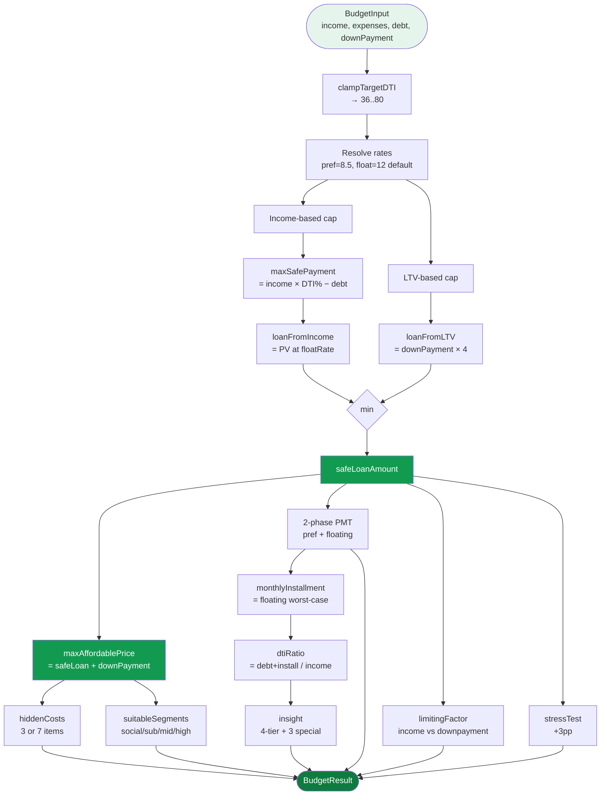

# 04 — Budget engine pipeline

`calculateBudget(input: BudgetInput): BudgetResult` — entry point chính của feature.
File: `features/budget/utils/budget-calculator.ts:650`.

## Visual overview

Diagram tách rời cho user dễ nhìn: [[diagrams/budget-pipeline.excalidraw|🎨 budget-pipeline (Excalidraw)]]



## Pipeline đầu-cuối

```
INPUT  { netIncome, monthlyExpenses, monthlyDebt, downPayment, interestRate?, loanTerm?, targetDTI? }
  │
  ├─ Step 1: Clamp targetDTI vào [36, 80]                      → clampTargetDTI()
  ├─ Step 2: Resolve rates                                     → prefRate=8.5, prefYears=2
  │           floatRate = input.interestRate ?? 12 (DEFAULT_FLOATING_RATE)
  │           safeCalcRate = floatingRate  (← KEY: worst-case)
  │
  ├─ Step 3: weightedAverageRate (display only)                → calculateWeightedRate()
  │
  ├─ Step 4: Income-based cap
  │           maxSafePayment = max(0, netIncome × targetDTI% − monthlyDebt)
  │           loanFromIncome = PV(maxSafePayment, floatRate, loanTerm)
  │                                                            → calculateLoanFromPayment()
  │
  ├─ Step 5: LTV-based cap
  │           loanFromLTV = (downPayment / 0.2) × 0.8           ← (assumes 20% min down)
  │
  ├─ Step 6: Dual-constraint
  │           safeLoanAmount = min(loanFromIncome, loanFromLTV)
  │           maxAffordablePrice = safeLoanAmount + downPayment
  │
  ├─ Step 7: Two-phase payments
  │           monthlyPreferential = PMT(safeLoan, prefRate, term)
  │           monthlyFloating     = PMT(safeLoan, floatRate, term)
  │           monthlyInstallment  = monthlyFloating  (worst case shown to user)
  │
  ├─ Step 8: Actual DTI (with new installment)
  │           dtiRatio = (monthlyDebt + monthlyInstallment) / netIncome × 100
  │
  ├─ Step 9: Affordability check (warning, not cap)
  │           disposable = income − expenses − debt − installment
  │           affordabilityWarning = safeLoan > 0 && disposable < 0
  │
  ├─ Step 10: LTV computed (display)
  │           ltv = safeLoan / maxAffordablePrice × 100
  │
  ├─ Step 11: Min down payment required (20% of maxPrice)
  │
  ├─ Step 12: Two-phase total cost (gốc + lãi)
  │                                                            → calculateTwoPhaseTotal()
  │
  ├─ Step 13: limitingFactor (income vs downpayment)           → generateLimitingFactor()
  ├─ Step 14: insight (4-tier copy)                            → generateInsight()
  ├─ Step 15: hiddenCosts (3 or 7 items)                       → calculateHiddenCosts()
  ├─ Step 16: suitableSegments (4 phân khúc)                   → generateSuitableSegments()
  ├─ Step 17: simulatedLoanAmount (only when safeLoan=0 + có vốn)
  └─ Step 18: stressTest (+3pp foresight)                      → calculateStressTest()
       │
       ▼
OUTPUT BudgetResult { …18 fields above… }
```

## Dual constraint — heart của engine

```ts
safeLoanAmount = min(loanFromIncome, loanFromLTV)
```

**Income-based cap** giả định: phần thu nhập tối đa user sẵn sàng dành cho trả nợ = `targetDTI%`. Trừ đi nợ hiện tại → còn lại là budget cho khoản vay mới. PV của khoản trả này (tại `floatingRate`) = mức vay an toàn từ thu nhập.

**LTV-based cap** giả định: VN bank không cho vay > 80% giá nhà. Nếu user có $X$ vốn tự có và nó là 20% giá nhà thì giá nhà = $5X$, khoản vay = $4X = 0.8 \cdot 5X$. Công thức gọn:
$$
\text{loanFromLTV} = \frac{\text{downPayment}}{0.2} \times 0.8 = 4 \cdot \text{downPayment}
$$

Cái nào nhỏ hơn → đó là **limiting factor** (xem [[06-insights-and-limits]]).

## Tại sao dùng floating rate cho safe-loan?

Lãi ưu đãi chỉ 2 năm đầu. Sau đó user phải trả ở `floatingRate` (cao hơn nhiều). Nếu cap khoản vay theo `preferentialRate` → user vay quá nhiều, hết ưu đãi sẽ vỡ kế hoạch (default risk).

Engine cố tình "bi quan": **size loan cho worst case, không phải teaser rate**.

Tradeoff: budget hơi thấp hơn ngân hàng VN duyệt thực tế, nhưng buyer ít rủi ro shock sau 2 năm.

## Live preview cho input screen

`estimateBudgetPreview()` (cùng file, line 118) — lightweight version dùng cho BudgetScreen real-time. Cùng logic dual-constraint, output:

```ts
interface BudgetPreview {
  loanFromIncome, loanFromLTV, safeLoan,
  estimatedInstallment, estimatedDTI, currentDTI,
  estimatedPrice, downPercent, ltv, isLtvLimited,
  downPaymentRatio, disposableAfterPayment,
}
```

**Single source of truth**: BudgetScreen KHÔNG tự tính, chỉ memoize `estimateBudgetPreview()`. Khi user bấm "Tính ngay" → gọi `calculateBudget()` (versions giàu hơn).

## Conditional output fields

3 field optional, không emit khi không cần:

| Field                  | Khi nào có                            |
| ---------------------- | ------------------------------------- |
| `simulatedLoanAmount`  | `safeLoan=0` AND `downPayment>0`      |
| `affordabilityWarning` | `safeLoan>0` AND `disposable<0`       |
| `stressTest`           | `safeLoan>0` AND `netIncome>0`        |

Spread pattern `...(simulatedLoanAmount != null && { simulatedLoanAmount })` — không pollute output với undefined.

## Pure function guarantees

- **Deterministic**: same input ⇒ same output.
- **No I/O**: không gọi network, không touch storage, không Date.now() (trừ `assumptions-snapshot` nhận `computedAt` param).
- **No mutation**: input không bị modify.
- **Offline-capable**: app chạy được không có internet.

→ Lý do server-side `budget-api.ts:calculateBudget()` POST endpoint **chưa được dùng** trong production flow (UI gọi pure function trực tiếp). Endpoint dự phòng cho khi cần sync logic giữa nhiều devices.

→ [[05-dti-perspectives]] · [[06-insights-and-limits]] · [[09-loan-comparison]]
