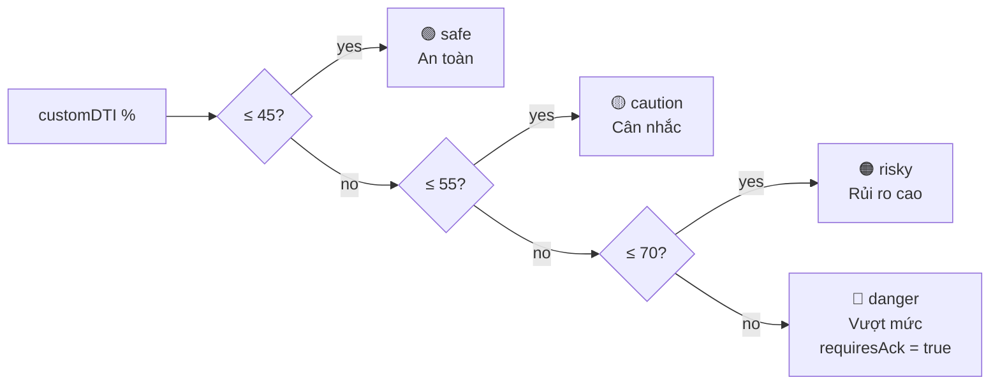

# 05 — DTI perspectives ("Mức trả nợ an toàn")

User-selectable ceiling cho **% thu nhập tối đa dành cho trả nợ**. 3 modes:

| Mode      | % thu nhập | Nguồn                                     |
| --------- | ---------- | ----------------------------------------- |
| `global`  | **36%**    | Quy tắc 28/36 (Mỹ)                        |
| `asia`    | **55%**    | Singapore TDSR — Total Debt Servicing Ratio |
| `custom`  | **36–80%** | User tự chọn — vùng nguy hiểm nếu ≥ 60%   |

```ts
DTI_PRESETS = { global: 36, asia: 55 } as const;
CUSTOM_DTI_MIN = 36;
CUSTOM_DTI_MAX = 80;
TARGET_DTI = 36;  // default = global
type DtiMode = "global" | "asia" | "custom";
```

## Tại sao % == DTI displayed

Engine design: **ceiling đã chọn = trực tiếp share thu nhập đi vào trả nợ.**

```ts
maxSafePayment = netIncome × (targetDTI / 100) − monthlyDebt
```

Living expenses (`monthlyExpenses`) **không** ăn vào cap — chỉ feed `disposableAfterPayment` để check warning. Logic này cố ý — surface, don't hide.

→ Nếu user chọn 55% và income 50M, nợ 5M → max payment cho khoản vay mới = 50×0.55 − 5 = 22.5M.

## Clamp logic

```ts
clampTargetDTI(value): number {
  if (value == null || !Number.isFinite(value)) return TARGET_DTI;  // 36
  return Math.max(36, Math.min(80, value));
}
```

Áp dụng cho cả Compass wizard, what-if, và direct API. Out-of-range → silently clamp (không throw).

## Compliance gate — Custom DTI ≥ 70%

`features/budget/utils/risk-copy.ts:requiresRiskAcknowledgment()` returns true khi `customDTI ≥ 70`.

Đây là `danger` tier trong 4-tone ladder của `getCustomRiskCopy()`:



`getSafetyChip()` consume cùng ladder để render single source of truth cho chip label trên cards (tránh OverviewCard / DTISection drift).

### Engine-flag overrides (Issue 1 fix, 06-2026)

`getSafetyChip()` nhận thêm 3 opts từ `BudgetResult` để reconcile chip với banner:

```ts
getSafetyChip(targetDTI, {
  isBlocked,               // → "Chưa đủ điều kiện"     (danger)
  belowMarketFloor,        // → "Dưới ngưỡng" (danger)
  affordabilityWarning,    // → "Vượt khả năng" (risky)
  lifeEventBufferLow,      // → "Đệm mỏng"    (caution)
})
```

Priority: `isBlocked > belowMarketFloor > affordabilityWarning > lifeEventBufferLow > targetDTI ladder`.

Lý do: trước đây chip chỉ dựa vào `targetDTI` (ceiling user CHỌN) → có thể xanh "An toàn" trong khi banner đỏ "Vượt khả năng". 2 nguồn truth disagree. Fix forward engine flags để override.

Trigger: BudgetScreen `handleViewResults()` — Alert fires khi `customDTI ≥ 70`:

```ts
if (dtiMode === "custom" && requiresRiskAcknowledgment(customDTI)) {
  Alert.alert("Mức trả nợ rủi ro cao", "...");
}
```

Copy:
> "Bạn đang chọn dành **X%** thu nhập để trả nợ — cao hơn mức hầu hết ngân hàng duyệt. Nếu thu nhập giảm hoặc lãi suất tăng, bạn dễ mất khả năng trả nợ."

2 actions: "Xem lại" (cancel, track resolved=false) · "Tôi hiểu, tiếp tục" (destructive style, track resolved=true rồi `submitCalculation()`).

Lý do compliance:
- **Vietnamese AI Law 134/2025** — transparency, user-informed risk acceptance.
- **SBV "hạn chế rủi ro"** — required disclosure cho high-risk financial decisions.

Analytics: `trackRiskAckShown(customDTI)` khi alert lên, `trackRiskAckResolved(accepted, customDTI)` khi user trả lời.

## Back-end DTI ceiling

```ts
MAX_DTI = 43;
```

Đây là **DTI ngân hàng VN chấp nhận**, không phải user-selectable. Engine dùng nó trong insight tiers:

- `dtiRatio ≤ 30` → "Tuyệt vời"
- `dtiRatio ≤ TARGET_DTI (36)` → "Tốt"
- `dtiRatio ≤ MAX_DTI (43)` → "Chấp nhận được"
- `dtiRatio > 43` → "Rủi ro cao — điều chỉnh"

Xem [[06-insights-and-limits]].

## Display vs target

Phân biệt 2 con số:

- **`targetDTI`** = ceiling user CHỌN (input vào engine).
- **`dtiRatio`** = ceiling THỰC TẾ user đang ăn (output). Có thể thấp hơn targetDTI khi LTV cap binding.

Khi `loanFromLTV < loanFromIncome` → installment thấp hơn ngưỡng cho phép → `dtiRatio < targetDTI`. UI hiển thị cả hai để user thấy "tôi đang dùng X% trong ngưỡng Y%".

## Perspective comparison

`BudgetResultScreen` có card `PerspectiveComparison` — so sánh 3 mode side-by-side. Recompute `calculateBudget()` 3 lần với targetDTI = 36 / 55 / customDTI rồi diff:
- Giá nhà tăng/giảm bao nhiêu khi đổi perspective
- Trả góp tăng/giảm
- DTI thực tế ở mỗi mode

Mục đích: user **thấy được tradeoff** trước khi quyết định ăn 55% income vs 36%.

## Migration & state

Persisted ở Zustand: `dtiMode` + `customDTI`. Default `dtiMode = "global"`, `customDTI = 36`.

```ts
targetDTI = dtiMode === "custom" ? customDTI : DTI_PRESETS[dtiMode];
```

User đổi perspective → store update → preview tự re-memoize → real-time feedback.

→ [[04-budget-engine]] step 1 + step 4 · [[06-insights-and-limits]]
