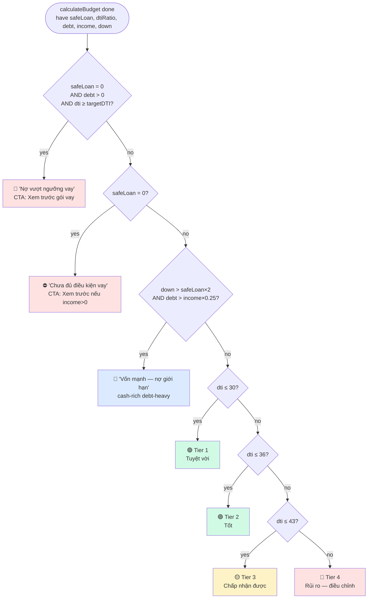

# 06 — Insights & limiting factor

2 layer narrative cho user: **WHAT** giới hạn họ (limitingFactor) + **HOW SAFE** họ đang ở (insight tier).

## Insight decision tree

Visual file: [[diagrams/insight-decision-tree.excalidraw|🎨 insight-decision-tree (Excalidraw)]]



**Priority**: Special cases (S1, S2, S3) check **TRƯỚC** standard tiers. First match wins.

> **Update 06-2026**: thêm special case `belowMarketFloor` (Issue 2 fix) — fire khi `maxAffordablePrice < MARKET_FLOOR_PRICE (500M)` AND `safeLoan > 0`. Override insight title thành "Chưa đạt ngưỡng giá thị trường". Lý do: math safe (DTI 20%) nhưng 250M không mua được nhà nào ở VN. Xem `12-tests-as-spec.md` `Issue 2` section.

---

## A. Limiting factor — "Yếu tố nào cap mức vay?"

`generateLimitingFactor()` ở `budget-calculator.ts:404`. Output:

```ts
{
  type: "income" | "downpayment",
  title: string,
  description: string,    // có số liệu cụ thể + hành động actionable
  loanFromIncome, loanFromLTV
}
```

Logic:

```
isIncomeLimited = loanFromIncome <= loanFromLTV

if safeLoan === 0 AND monthlyDebt > 0
  → type="income", "Nợ hiện tại vượt ngưỡng cho phép vay"
else if isIncomeLimited
  → type="income", "Thu nhập quyết định mức vay"
else
  → type="downpayment", "Tăng vốn tự có để mở rộng mức vay"
```

### Income-limited messaging

Tính cụ thể: tăng thu nhập bao nhiêu để vay được +20%?

```
targetLoanIncrease = safeLoan × 0.2
additionalPayment = PMT(targetLoanIncrease, floatingRate, term)
additionalIncomeNeeded = additionalPayment / (targetDTI / 100)
```

Copy:
> "Ngân hàng cho phép vay tối đa **X tỷ** dựa trên thu nhập **Y triệu/tháng**. Tăng thu nhập thêm **Z triệu/tháng** sẽ nâng mức vay thêm ~20%."

Nếu `monthlyDebt > 0`, append hint:
> " Giảm nợ hiện tại (W triệu/tháng) cũng giúp tăng mức vay."

### Down-payment-limited messaging

Tính tăng vốn bao nhiêu để unlock toàn bộ income capacity:

```
unlockableLoan = loanFromIncome − loanFromLTV
additionalDownPayment = unlockableLoan × 0.2/0.8 = unlockableLoan × 0.25
currentEquityPercent = downPayment / (downPayment + loanFromLTV)
```

Copy:
> "Thu nhập cho phép vay đến **X tỷ**, nhưng vốn tự có mới đạt **Y%** giá nhà. Thêm **Z triệu** vốn tự có sẽ mở khoá thêm **W tỷ** mức vay."

### Zero-loan + có debt — special case

Khi `safeLoanAmount === 0` AND `monthlyDebt > 0`: nợ hiện tại đã ăn hết DTI capacity, không vay được nữa.

```
dtiCapacity = netIncome × targetDTI%
gap = monthlyDebt − dtiCapacity         // overshoot
targetFirstLoan = 500_000_000           // 500M — "first meaningful loan"
paymentForTarget = PMT(500M, 12%, 20y)
debtReductionForTarget = gap + paymentForTarget
incomeIncreaseForTarget = (gap + paymentForTarget) / targetDTI%
```

Copy nhân văn hơn — explain WHY + 2 escape paths (giảm nợ X/tháng HOẶC tăng thu nhập Y/tháng).

---

## B. Insight tiers — "Tôi đang ở mức nào?"

`generateInsight()` ở `budget-calculator.ts:213`. Output:

```ts
{ title, description, loanPackageButtonText? }
```

Hiển thị trên BudgetResultScreen như "Nhận định từ chuyên gia".

### 4-tier system (chuẩn — happy path)

| Tier                    | Condition                       | Title                                        |
| ----------------------- | ------------------------------- | -------------------------------------------- |
| Tuyệt vời               | `dtiRatio ≤ 30`                 | "Khả năng tài chính tuyệt vời"               |
| Tốt                     | `dtiRatio ≤ TARGET_DTI (36)`    | "Tình hình tài chính tốt"                    |
| Chấp nhận được          | `dtiRatio ≤ MAX_DTI (43)`       | "Tình hình tài chính chấp nhận được"         |
| Rủi ro cao              | `dtiRatio > 43`                 | "Nên điều chỉnh để tăng cơ hội duyệt vay"    |

Mỗi tier kèm:
- `dtiRatio` thực tế dạng %
- Gợi ý quỹ dự phòng = `monthlyInstallment × 6` tháng
- CTA button (`loanPackageButtonText`) khác nhau:
  - Tier 1-2: "Xem gói vay tối ưu"
  - Tier 3: "Khám phá gói vay phù hợp"
  - Tier 4: "So sánh gói vay linh hoạt"

### 2 special cases — OVERRIDE chuẩn

**Special 1 — Zero loan + debt blocks borrowing**

```
if safeLoan === 0 AND monthlyDebt > 0 AND dtiRatio >= targetDTI
```

Title: "Nợ hiện tại vượt ngưỡng vay"

Copy:
> "Nợ hàng tháng (X triệu) đã chiếm Y% thu nhập — vượt ngưỡng an toàn Z%. Bạn vẫn có thể xem trước các gói vay để lên kế hoạch."

CTA: "Xem trước gói vay" (vẫn cho preview để motivation).

**Special 2 — Zero loan, no debt** (income quá thấp)

```
if safeLoan === 0  // và không match special 1
```

Title: "Chưa đủ điều kiện vay"
Copy:
> "Với thu nhập hiện tại, ngân sách chỉ bao gồm vốn tự có. Tăng thu nhập sẽ mở rộng ngân sách mua nhà."

CTA: "Xem trước gói vay" (nếu `netIncome > 0`) hoặc không CTA.

**Special 3 — Cash-rich, debt-heavy**

```
if downPayment > safeLoan × 2 AND monthlyDebt > netIncome × 0.25
```

User có vốn mạnh nhưng nợ ăn DTI capacity. Acknowledge strength trước rồi chỉ bottleneck.

Title: "Vốn mạnh — nợ đang giới hạn mức vay"
Copy:
> "Bạn có **X tỷ** vốn tự có — nền tảng rất tốt. Tuy nhiên nợ hàng tháng (**Y triệu**) đang chiếm phần lớn ngưỡng vay. Giảm nợ sẽ giúp mức vay tăng đáng kể."

Priority: special 3 check **TRƯỚC** standard tiers — bypass tier copy nếu match.

## Order of evaluation (insight)

```
1. zero-loan + debt + over-DTI         → "Nợ vượt ngưỡng"
2. zero-loan (any other)               → "Chưa đủ điều kiện"
3. cash-rich debt-heavy                → "Vốn mạnh — nợ giới hạn"
4. dtiRatio ≤ 30                       → "Tuyệt vời"
5. dtiRatio ≤ 36                       → "Tốt"
6. dtiRatio ≤ 43                       → "Chấp nhận được"
7. else                                → "Rủi ro cao — điều chỉnh"
```

## Tại sao 4 tiers, không 3 hay 5?

- **3 tiers** không phân biệt được "tuyệt vời" (≤30) với "tốt" (30-36) — user safe vẫn cần khuyến khích.
- **5 tiers** quá rời rạc — user khó phân biệt 2 tier sát nhau.
- 4 tiers map 1-1 với DTI thresholds VN bank (30 = thoải mái / 36 = ngưỡng an toàn quốc tế / 43 = ngưỡng duyệt thực tế).

Threshold `30` cố ý không export — chỉ inline trong `generateInsight()`.

→ [[05-dti-perspectives]] · [[04-budget-engine]] step 13-14
